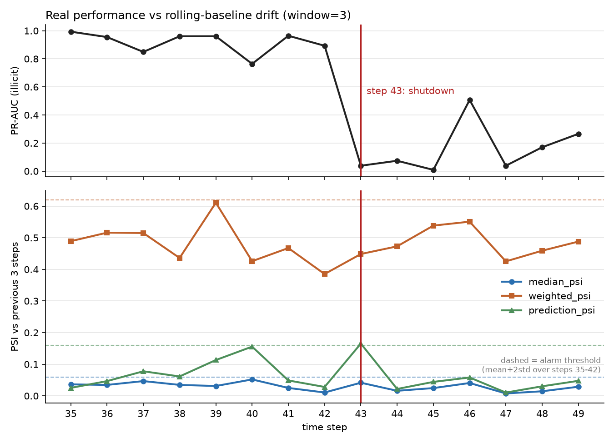

# ChainSentinel

[](https://github.com/poorna825/chainsentinel/actions/workflows/tests.yml)

Flags illicit Bitcoin transactions using machine learning, trained on the public
[Elliptic dataset](https://arxiv.org/abs/1908.02591) (~200k real transactions, a subset labeled
licit/illicit), plus drift monitoring to check whether the model goes stale as new data arrives.

> Personal learning project, not production software. Built incrementally, directly in `src/`.

## Setup

```bash
python -m venv .venv
# Windows: .venv\Scripts\activate     macOS/Linux: source .venv/bin/activate
pip install -r requirements.txt
```

Download the Elliptic dataset from
[Kaggle](https://www.kaggle.com/datasets/ellipticco/elliptic-data-set) and put
`elliptic_txs_features.csv`, `elliptic_txs_classes.csv`, `elliptic_txs_edgelist.csv` in `data/`
(git-ignored). No data yet? Generate fake practice data instead:

```bash
python tests/make_fake_data.py data_fake
```

## Structure

```
src/          project code: data loading, metrics, models, graph features, drift, report scripts
notebooks/    exploration/visualization only
data/         raw CSVs (git-ignored)
results/      saved charts and tables
docs/         written-up results (docs/results.md)
tests/        pytest suite + fake-data generator
```

## How it works

- **`src/data.py`** — loads the Elliptic CSVs and splits train/test **by time**, not randomly
  (a random split would leak future transactions into training).
- **`src/metrics.py`** — illicit transactions are a small minority (~2% overall, ~10% of
  labeled), so plain accuracy is misleading. Tracks illicit-class precision/recall/F1 and PR-AUC
  instead.
- **`src/model.py`** — baseline logistic regression and random forest, weighted for the class
  imbalance.

## Key results

Details, tables and caveats: [docs/results.md](docs/results.md). Real Elliptic data, train on time
steps 1-34, test on 35-49.

- **Baseline:** random forest, pooled test PR-AUC about 0.80 (0.798, mean of 5 seeds).
- **Performance collapses at step 43.** PR-AUC is 0.89 at step 42 and 0.04 at step 43, the known
  dark-market shutdown, and stays low afterward (0.01-0.27, except 0.51 at step 46, which has only 2 illicit examples; step 45
  has 5, so those values are noisy).
- **Fixed-baseline PSI did not flag it.** Comparing every step against the training window kept
  weighted and prediction PSI far above the 0.25 "major" cutoff at every step 35-49 (median PSI
  was 0.17-0.47), so it can't separate the break from trend.
- **Rolling prediction-score PSI did, marginally.** With the rule pre-registered before running
  (baseline = previous 3 steps, alarm above mean + 2 std over steps 35-42), `prediction_psi`
  alarmed at step 43 and nowhere in 35-42 (0.165 vs a 0.159 threshold). Median and weighted
  feature PSI did not alarm. This is one metric on one event, the threshold is checked on the same
  steps it was fit on, and the alarm does not persist after step 43 - see the limitations in
  [docs/results.md](docs/results.md#rolling-baseline-drift).
- **Graph features gave no gain.** Degree and leakage-safe neighbor-prediction features did not
  improve PR-AUC; the bootstrap 95% CIs for the difference straddle zero (e.g. -0.0011, CI
  (-0.0032, 0.0009) for the 165-feature model).



## Roadmap

- [x] Data loading + time-based split
- [x] Illicit-class metrics (precision/recall/F1, PR-AUC) and baseline models
- [x] Graph-based features (degree, neighbor predictions) - tested, no gain
- [x] Drift monitoring (fixed-baseline and rolling-baseline PSI, prediction-score drift)
- [x] Tests (pytest, run in CI)
- [ ] GNN models (GCN, GraphSAGE, GAT)
- [ ] Explainability (SHAP)
- [ ] Dashboard

## Data source

Weber et al., *Anti-Money Laundering in Bitcoin: Experimenting with Graph Convolutional Networks
for Financial Forensics* (2019). https://arxiv.org/abs/1908.02591
